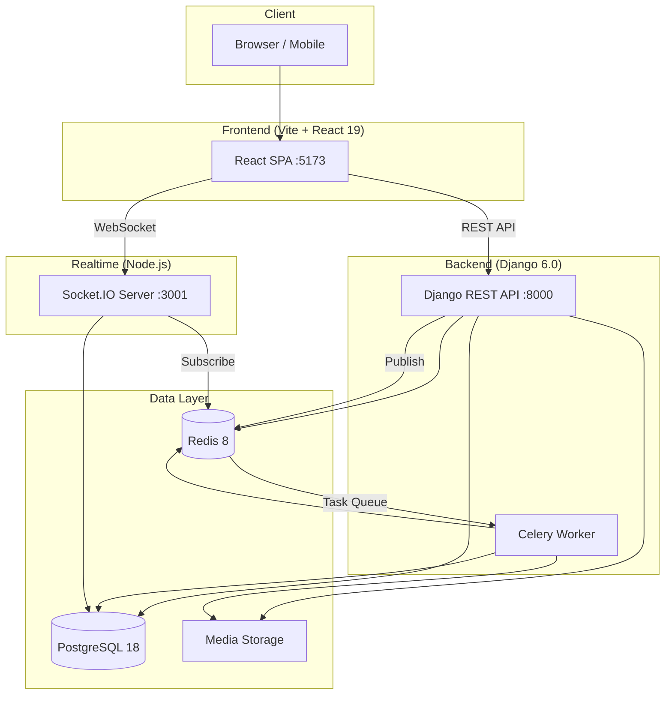
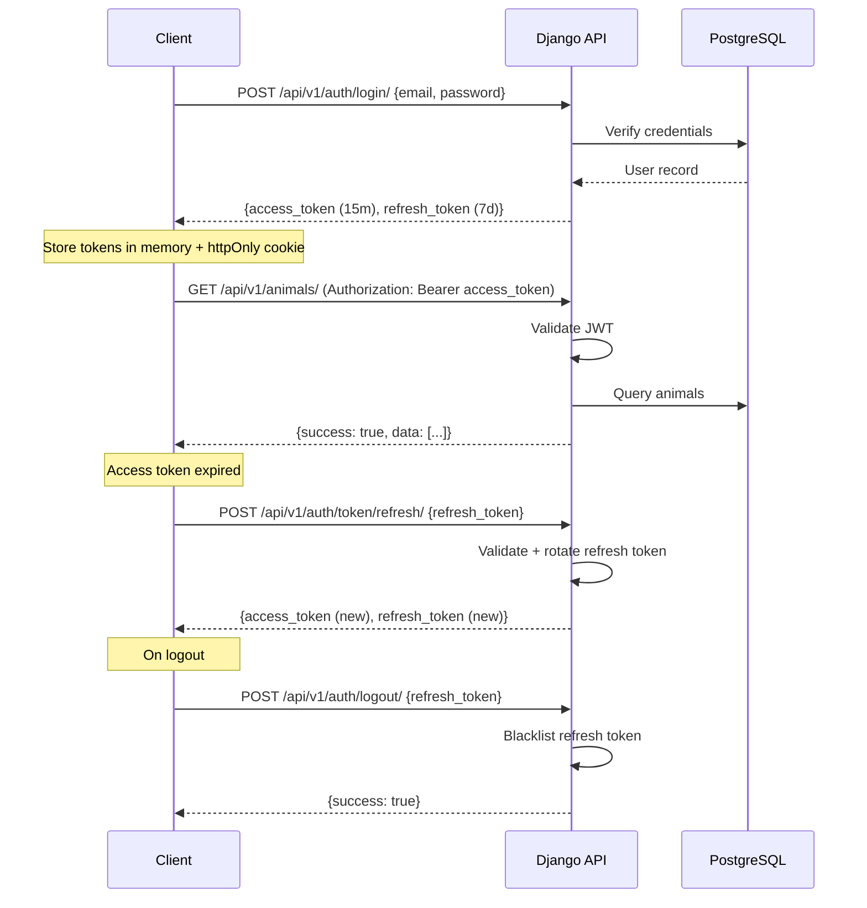
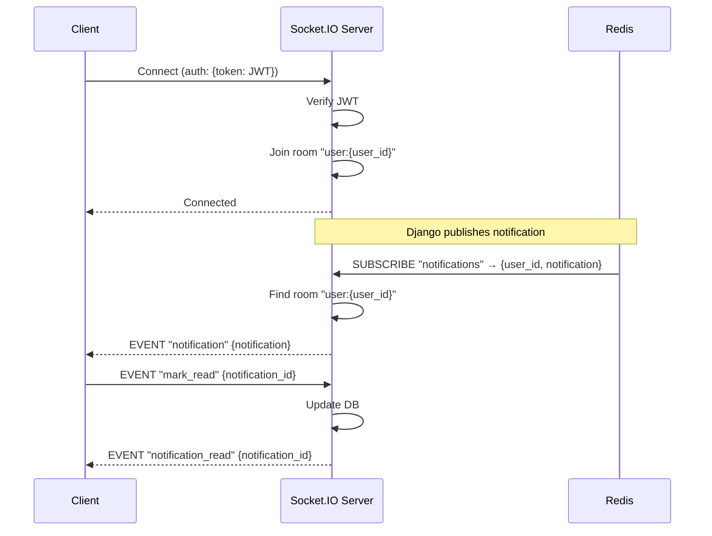

# Adawpt — System Architecture

## Overview

Adawpt uses a microservices-lite architecture with three main services: a Django REST backend, a React SPA frontend, and a Node.js real-time service, all orchestrated via Docker Compose.

---

## System Architecture Diagram



---

## Service Communication

### Request Flow (REST)
```
Browser → React SPA → Django REST API → PostgreSQL
                                      → Redis (caching)
                                      → Celery (async tasks)
```

### Real-time Flow (WebSocket)
```
Django API → Redis Pub/Sub → Socket.IO Server → Browser WebSocket
```

### Async Task Flow
```
Django API → Redis (task queue) → Celery Worker → PostgreSQL/Media
```

---

## Authentication Flow (JWT)



### Token Strategy
| Token | Lifetime | Storage | Purpose |
|---|---|---|---|
| Access Token | 15 minutes | JS memory (React state) | API authentication |
| Refresh Token | 7 days | httpOnly cookie or localStorage | Token renewal |

### Token Refresh Logic (Frontend)
1. Axios interceptor detects 401 response
2. If refresh token exists, call `/api/v1/auth/token/refresh/`
3. On success: update access token, retry original request
4. On failure: clear tokens, redirect to login

---

## API Design Patterns

### URL Structure
```
/api/v1/{resource}/                  # List, Create
/api/v1/{resource}/{id}/             # Retrieve, Update, Delete
/api/v1/{resource}/{id}/{sub}/       # Nested resources
/api/v1/{resource}/{id}/{action}/    # Custom actions
```

### Response Envelope
All API responses use a consistent envelope:

```json
{
  "success": true,
  "data": { ... },
  "message": "Operation successful",
  "errors": null
}
```

Error response:
```json
{
  "success": false,
  "data": null,
  "message": "Validation failed",
  "errors": {
    "email": ["This field is required."],
    "password": ["Must be at least 8 characters."]
  }
}
```

### Pagination
```json
{
  "success": true,
  "data": {
    "count": 150,
    "next": "/api/v1/animals/?page=3",
    "previous": "/api/v1/animals/?page=1",
    "results": [...]
  }
}
```

### Filtering
- Query parameters for filters: `?species=dog&status=available&gender=male`
- Search: `?search=golden retriever`
- Ordering: `?ordering=-created_at`
- Page: `?page=2&page_size=20`

### HTTP Status Codes
| Code | Usage |
|---|---|
| 200 | Success (GET, PUT, PATCH) |
| 201 | Created (POST) |
| 204 | No Content (DELETE) |
| 400 | Bad Request (validation error) |
| 401 | Unauthorized (missing/invalid token) |
| 403 | Forbidden (insufficient permissions) |
| 404 | Not Found |
| 429 | Rate Limited |
| 500 | Server Error |

---

## File Upload Strategy

### Upload Flow
1. Client sends multipart/form-data to Django API
2. Django validates file type and size
3. File saved to `MEDIA_ROOT/{model}/{year}/{month}/{filename}`
4. Celery task triggered for image processing (resize, compress, generate thumbnails)
5. File path stored in database

### File Validation
| Rule | Value |
|---|---|
| Max file size | 5 MB |
| Allowed image types | JPEG, PNG, WebP |
| Max images per report | 5 |
| Max images per animal | 10 |
| Thumbnail sizes | 150x150, 400x300, 800x600 |

### Storage Path Convention
```
media/
├── avatars/{user_id}/{filename}
├── reports/{report_id}/{filename}
├── animals/{animal_id}/{filename}
├── stories/{story_id}/{filename}
└── events/{event_id}/{filename}
```

### Image Processing (Celery Task)
```python
@shared_task
def process_image(image_path, sizes=None):
    """Resize and compress uploaded image."""
    # 1. Open with Pillow
    # 2. Auto-orient (EXIF)
    # 3. Generate thumbnails at specified sizes
    # 4. Compress (quality=85 for JPEG)
    # 5. Save optimized versions
```

---

## Redis Caching Strategy

### Cache Keys
| Key Pattern | TTL | Content |
|---|---|---|
| `user:{id}:profile` | 15 min | User profile data |
| `user:{id}:unread_count` | 5 min | Notification unread count |
| `animals:list:{hash}` | 5 min | Paginated animal listing |
| `animal:{id}:detail` | 10 min | Animal detail with images |
| `stats:dashboard` | 5 min | Dashboard aggregate stats |
| `report:{tracking_id}` | 10 min | Report status for public tracking |

### Cache Invalidation
- On model save/delete: clear related cache keys
- Use Django signals for automatic invalidation
- Prefix-based invalidation for list caches

### Redis Pub/Sub Channels
| Channel | Publisher | Subscriber | Payload |
|---|---|---|---|
| `notifications` | Django API | Socket.IO | `{user_id, notification}` |

---

## Celery Task Queue

### Tasks
| Task | Trigger | Priority |
|---|---|---|
| `process_image` | Image upload | Normal |
| `send_notification_email` | Notification created | Normal |
| `generate_report_tracking_id` | Report created | High |
| `cleanup_expired_tokens` | Periodic (daily) | Low |
| `expire_stale_applications` | Periodic (hourly) | Low |
| `aggregate_dashboard_stats` | Periodic (every 5 min) | Low |
| `cleanup_old_notifications` | Periodic (weekly) | Low |

### Configuration
```python
CELERY_BROKER_URL = 'redis://redis:6379/0'
CELERY_RESULT_BACKEND = 'redis://redis:6379/0'
CELERY_TASK_SERIALIZER = 'json'
CELERY_ACCEPT_CONTENT = ['json']
CELERY_TIMEZONE = 'Asia/Manila'
```

---

## WebSocket Design (Socket.IO)

### Connection Flow


### Events
| Event | Direction | Payload |
|---|---|---|
| `notification` | Server → Client | `{id, type, title, message, data, created_at}` |
| `notification_read` | Server → Client | `{notification_id}` |
| `unread_count` | Server → Client | `{count}` |
| `mark_read` | Client → Server | `{notification_id}` |
| `mark_all_read` | Client → Server | `{}` |

### Rooms
- `user:{user_id}` — Personal notification room
- Each user joins their room on connection

---

## Security Architecture

### Authentication Layers
1. **JWT Validation:** Every API request (except public endpoints)
2. **Permission Classes:** Role-based access control per view
3. **Object-level Permissions:** Ownership checks (e.g., adopter can only see their own applications)

### Security Headers
- `X-Content-Type-Options: nosniff`
- `X-Frame-Options: DENY`
- `Strict-Transport-Security` (production)
- CORS restricted to frontend origin

### Rate Limiting
| Endpoint | Rate |
|---|---|
| `/api/v1/auth/login/` | 5/minute |
| `/api/v1/auth/register/` | 3/minute |
| `/api/v1/auth/token/refresh/` | 10/minute |
| All other endpoints | 100/minute |

### Input Validation
- DRF serializers validate all input
- File uploads validated by type and size
- Query parameters sanitized
- No raw SQL queries (ORM only)

---

## Error Handling

### Backend
- Custom DRF exception handler wraps all errors in standard envelope
- Unhandled exceptions return generic 500 with no stack trace (production)
- All errors logged with full context

### Frontend
- Global Axios error interceptor
- React Error Boundary for component crashes
- Toast notifications for user-facing errors
- Retry logic for network failures (exponential backoff)

---

## Monitoring (Future)

- Django: django-silk for query profiling
- Application: Sentry for error tracking
- Infrastructure: Docker health checks
- Logs: Structured JSON logging to stdout
