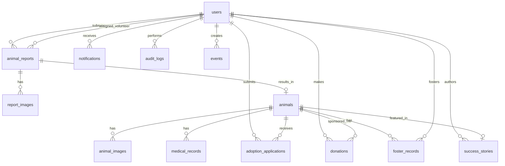

# Adawpt — Database Schema

## Overview

PostgreSQL 18 database with UUID v7 primary keys (time-ordered), timestamp tracking on all tables, and proper indexing for query performance.

---

## ER Diagram

---

## Tables

### 1. `users`

Custom user model with email-based authentication.

| Column | Type | Constraints | Description |
|---|---|---|---|
| `id` | `UUID` | PK, default uuid7 | Unique identifier |
| `email` | `VARCHAR(255)` | UNIQUE, NOT NULL | Login email |
| `password` | `VARCHAR(128)` | NOT NULL | Hashed password (Django PBKDF2) |
| `first_name` | `VARCHAR(150)` | NOT NULL | First name |
| `last_name` | `VARCHAR(150)` | NOT NULL | Last name |
| `role` | `VARCHAR(20)` | NOT NULL, default 'reporter' | ENUM: admin, shelter_staff, volunteer, adopter, reporter |
| `phone` | `VARCHAR(20)` | NULL | Philippine phone number |
| `address` | `TEXT` | NULL | Full address |
| `avatar` | `VARCHAR(500)` | NULL | Avatar image path |
| `is_active` | `BOOLEAN` | default TRUE | Account active status |
| `is_staff` | `BOOLEAN` | default FALSE | Django admin access |
| `is_superuser` | `BOOLEAN` | default FALSE | Django superuser |
| `email_verified` | `BOOLEAN` | default FALSE | Email verification status |
| `last_login` | `TIMESTAMPTZ` | NULL | Last login timestamp |
| `date_joined` | `TIMESTAMPTZ` | default NOW | Account creation |
| `created_at` | `TIMESTAMPTZ` | default NOW | Record creation |
| `updated_at` | `TIMESTAMPTZ` | auto-update | Record update |

**Indexes:**
- `idx_users_email` — UNIQUE on `email`
- `idx_users_role` — on `role`
- `idx_users_is_active` — on `is_active`

---

### 2. `animal_reports`

Stray/abuse reports submitted by citizens.

| Column | Type | Constraints | Description |
|---|---|---|---|
| `id` | `UUID` | PK, default uuid7 | Unique identifier |
| `tracking_id` | `VARCHAR(12)` | UNIQUE, NOT NULL | Public tracking code (e.g., RPT-XXXX-XXXX) |
| `reporter_id` | `UUID` | FK → users, NULL | Reporter (NULL for anonymous) |
| `assigned_volunteer_id` | `UUID` | FK → users, NULL | Assigned volunteer |
| `animal_type` | `VARCHAR(50)` | NOT NULL | dog, cat, bird, other |
| `description` | `TEXT` | NOT NULL | Description of animal/situation |
| `urgency` | `VARCHAR(20)` | NOT NULL | critical, high, medium, low |
| `status` | `VARCHAR(20)` | NOT NULL, default 'submitted' | Workflow status |
| `latitude` | `DECIMAL(10,8)` | NULL | Location latitude |
| `longitude` | `DECIMAL(11,8)` | NULL | Location longitude |
| `address` | `TEXT` | NULL | Human-readable location |
| `reporter_name` | `VARCHAR(200)` | NULL | Name for anonymous reporters |
| `reporter_phone` | `VARCHAR(20)` | NULL | Phone for anonymous reporters |
| `reporter_email` | `VARCHAR(255)` | NULL | Email for anonymous reporters |
| `admin_notes` | `TEXT` | NULL | Internal notes |
| `resolved_at` | `TIMESTAMPTZ` | NULL | When report was resolved |
| `resulting_animal_id` | `UUID` | FK → animals, NULL | Animal profile created from rescue |
| `created_at` | `TIMESTAMPTZ` | default NOW | Report submission time |
| `updated_at` | `TIMESTAMPTZ` | auto-update | Last update |

**Indexes:**
- `idx_reports_tracking_id` — UNIQUE on `tracking_id`
- `idx_reports_status` — on `status`
- `idx_reports_urgency` — on `urgency`
- `idx_reports_reporter` — on `reporter_id`
- `idx_reports_volunteer` — on `assigned_volunteer_id`
- `idx_reports_created` — on `created_at` DESC
- `idx_reports_status_urgency` — COMPOSITE on (`status`, `urgency`)

**Status Values:** `submitted`, `acknowledged`, `dispatched`, `rescued`, `sheltered`, `closed`

---

### 3. `report_images`

Photos attached to animal reports.

| Column | Type | Constraints | Description |
|---|---|---|---|
| `id` | `UUID` | PK, default uuid7 | Unique identifier |
| `report_id` | `UUID` | FK → animal_reports, NOT NULL, CASCADE | Parent report |
| `image` | `VARCHAR(500)` | NOT NULL | Image file path |
| `caption` | `VARCHAR(255)` | NULL | Optional caption |
| `order` | `INTEGER` | default 0 | Display order |
| `created_at` | `TIMESTAMPTZ` | default NOW | Upload time |

**Indexes:**
- `idx_report_images_report` — on `report_id`

---

### 4. `animals`

Animal profiles managed by shelter.

| Column | Type | Constraints | Description |
|---|---|---|---|
| `id` | `UUID` | PK, default uuid7 | Unique identifier |
| `name` | `VARCHAR(100)` | NOT NULL | Animal name |
| `species` | `VARCHAR(50)` | NOT NULL | dog, cat, bird, rabbit, other |
| `breed` | `VARCHAR(100)` | NULL | Breed or mix |
| `age_years` | `INTEGER` | NULL | Estimated age in years |
| `age_months` | `INTEGER` | NULL | Estimated age in months |
| `gender` | `VARCHAR(10)` | NOT NULL | male, female, unknown |
| `weight_kg` | `DECIMAL(5,2)` | NULL | Weight in kilograms |
| `color` | `VARCHAR(100)` | NULL | Color/markings |
| `description` | `TEXT` | NULL | Personality and details |
| `temperament` | `VARCHAR(255)` | NULL | Temperament tags |
| `special_needs` | `TEXT` | NULL | Special care requirements |
| `is_spayed_neutered` | `BOOLEAN` | default FALSE | Spay/neuter status |
| `is_vaccinated` | `BOOLEAN` | default FALSE | Vaccination status |
| `is_good_with_kids` | `BOOLEAN` | NULL | Good with children |
| `is_good_with_pets` | `BOOLEAN` | NULL | Good with other pets |
| `status` | `VARCHAR(30)` | NOT NULL, default 'intake' | Current status |
| `intake_date` | `DATE` | NOT NULL | Date entered shelter |
| `adoption_date` | `DATE` | NULL | Date adopted |
| `adopted_by_id` | `UUID` | FK → users, NULL | Adopter |
| `created_by_id` | `UUID` | FK → users, NOT NULL | Staff who created profile |
| `created_at` | `TIMESTAMPTZ` | default NOW | Record creation |
| `updated_at` | `TIMESTAMPTZ` | auto-update | Last update |

**Indexes:**
- `idx_animals_species` — on `species`
- `idx_animals_status` — on `status`
- `idx_animals_gender` — on `gender`
- `idx_animals_breed` — on `breed`
- `idx_animals_created` — on `created_at` DESC
- `idx_animals_species_status` — COMPOSITE on (`species`, `status`)

**Status Values:** `intake`, `medical_evaluation`, `treatment`, `available`, `adoption_pending`, `adopted`, `fostered`, `transferred`, `deceased`

---

### 5. `animal_images`

Photo gallery for animal profiles.

| Column | Type | Constraints | Description |
|---|---|---|---|
| `id` | `UUID` | PK, default uuid7 | Unique identifier |
| `animal_id` | `UUID` | FK → animals, NOT NULL, CASCADE | Parent animal |
| `image` | `VARCHAR(500)` | NOT NULL | Image file path |
| `caption` | `VARCHAR(255)` | NULL | Optional caption |
| `is_primary` | `BOOLEAN` | default FALSE | Primary display image |
| `order` | `INTEGER` | default 0 | Display order |
| `created_at` | `TIMESTAMPTZ` | default NOW | Upload time |

**Indexes:**
- `idx_animal_images_animal` — on `animal_id`
- `idx_animal_images_primary` — on (`animal_id`, `is_primary`) WHERE `is_primary` = TRUE

---

### 6. `medical_records`

Veterinary records for animals (append-only).

| Column | Type | Constraints | Description |
|---|---|---|---|
| `id` | `UUID` | PK, default uuid7 | Unique identifier |
| `animal_id` | `UUID` | FK → animals, NOT NULL, CASCADE | Parent animal |
| `record_type` | `VARCHAR(30)` | NOT NULL | vaccination, treatment, surgery, checkup, medication, note |
| `title` | `VARCHAR(200)` | NOT NULL | Record title |
| `description` | `TEXT` | NULL | Detailed notes |
| `veterinarian` | `VARCHAR(200)` | NULL | Vet name |
| `record_date` | `DATE` | NOT NULL | Date of medical event |
| `next_due_date` | `DATE` | NULL | Follow-up date |
| `created_by_id` | `UUID` | FK → users, NOT NULL | Staff who created record |
| `created_at` | `TIMESTAMPTZ` | default NOW | Record creation |

**Indexes:**
- `idx_medical_animal` — on `animal_id`
- `idx_medical_type` — on `record_type`
- `idx_medical_date` — on `record_date` DESC
- `idx_medical_next_due` — on `next_due_date` WHERE `next_due_date` IS NOT NULL

---

### 7. `adoption_applications`

Adoption applications from prospective adopters.

| Column | Type | Constraints | Description |
|---|---|---|---|
| `id` | `UUID` | PK, default uuid7 | Unique identifier |
| `applicant_id` | `UUID` | FK → users, NOT NULL | Adopter applying |
| `animal_id` | `UUID` | FK → animals, NOT NULL | Animal being applied for |
| `status` | `VARCHAR(30)` | NOT NULL, default 'submitted' | Application status |
| `housing_type` | `VARCHAR(30)` | NOT NULL | house, apartment, condo, other |
| `owns_or_rents` | `VARCHAR(10)` | NOT NULL | owns, rents |
| `landlord_permission` | `BOOLEAN` | NULL | Has landlord permission (if renting) |
| `has_yard` | `BOOLEAN` | NOT NULL | Has yard/outdoor space |
| `other_pets` | `TEXT` | NULL | Description of other pets |
| `children_info` | `TEXT` | NULL | Children ages and info |
| `pet_experience` | `TEXT` | NOT NULL | Previous pet ownership experience |
| `work_schedule` | `TEXT` | NOT NULL | Work schedule and time available |
| `vet_reference` | `TEXT` | NULL | Veterinarian reference |
| `personal_references` | `TEXT` | NOT NULL | Two personal references |
| `reason_to_adopt` | `TEXT` | NOT NULL | Why they want this animal |
| `agrees_to_home_visit` | `BOOLEAN` | NOT NULL | Consent to home visit |
| `staff_notes` | `TEXT` | NULL | Internal staff notes |
| `rejection_reason` | `TEXT` | NULL | Internal rejection reason |
| `rejection_message` | `TEXT` | NULL | Message sent to adopter |
| `interview_date` | `TIMESTAMPTZ` | NULL | Scheduled interview datetime |
| `reviewed_by_id` | `UUID` | FK → users, NULL | Staff reviewer |
| `reviewed_at` | `TIMESTAMPTZ` | NULL | Review timestamp |
| `created_at` | `TIMESTAMPTZ` | default NOW | Application submission |
| `updated_at` | `TIMESTAMPTZ` | auto-update | Last update |

**Indexes:**
- `idx_adoption_applicant` — on `applicant_id`
- `idx_adoption_animal` — on `animal_id`
- `idx_adoption_status` — on `status`
- `idx_adoption_unique_active` — UNIQUE on (`applicant_id`, `animal_id`) WHERE `status` NOT IN ('rejected', 'withdrawn')
- `idx_adoption_created` — on `created_at` DESC

**Status Values:** `submitted`, `under_review`, `interview_scheduled`, `approved`, `rejected`, `withdrawn`, `expired`

---

### 8. `donations`

Financial donations and sponsorships.

| Column | Type | Constraints | Description |
|---|---|---|---|
| `id` | `UUID` | PK, default uuid7 | Unique identifier |
| `donor_id` | `UUID` | FK → users, NULL | Donor (NULL for anonymous) |
| `animal_id` | `UUID` | FK → animals, NULL | Sponsored animal (if sponsorship) |
| `amount` | `DECIMAL(10,2)` | NOT NULL | Donation amount in PHP |
| `donation_type` | `VARCHAR(20)` | NOT NULL | one_time, monthly, sponsorship |
| `payment_status` | `VARCHAR(20)` | NOT NULL, default 'pending' | pending, completed, failed, refunded |
| `payment_reference` | `VARCHAR(100)` | NULL | Payment gateway reference |
| `is_anonymous` | `BOOLEAN` | default FALSE | Hide donor identity |
| `donor_name` | `VARCHAR(200)` | NULL | Name for anonymous donors |
| `donor_email` | `VARCHAR(255)` | NULL | Email for anonymous donors |
| `message` | `TEXT` | NULL | Donor message |
| `is_recurring` | `BOOLEAN` | default FALSE | Is recurring donation |
| `recurring_status` | `VARCHAR(20)` | NULL | active, paused, cancelled |
| `next_payment_date` | `DATE` | NULL | Next recurring payment |
| `created_at` | `TIMESTAMPTZ` | default NOW | Donation time |
| `updated_at` | `TIMESTAMPTZ` | auto-update | Last update |

**Indexes:**
- `idx_donations_donor` — on `donor_id`
- `idx_donations_animal` — on `animal_id`
- `idx_donations_type` — on `donation_type`
- `idx_donations_status` — on `payment_status`
- `idx_donations_created` — on `created_at` DESC
- `idx_donations_recurring` — on (`is_recurring`, `recurring_status`) WHERE `is_recurring` = TRUE

---

### 9. `success_stories`

Published adoption success stories.

| Column | Type | Constraints | Description |
|---|---|---|---|
| `id` | `UUID` | PK, default uuid7 | Unique identifier |
| `title` | `VARCHAR(200)` | NOT NULL | Story title |
| `slug` | `VARCHAR(250)` | UNIQUE, NOT NULL | URL-friendly slug |
| `body` | `TEXT` | NOT NULL | Story content (rich text) |
| `excerpt` | `TEXT` | NULL | Short preview text |
| `featured_image` | `VARCHAR(500)` | NULL | Main image path |
| `animal_id` | `UUID` | FK → animals, NULL | Featured animal |
| `author_id` | `UUID` | FK → users, NOT NULL | Author (staff) |
| `is_published` | `BOOLEAN` | default FALSE | Published status |
| `is_featured` | `BOOLEAN` | default FALSE | Show on landing page |
| `published_at` | `TIMESTAMPTZ` | NULL | Publication date |
| `created_at` | `TIMESTAMPTZ` | default NOW | Record creation |
| `updated_at` | `TIMESTAMPTZ` | auto-update | Last update |

**Indexes:**
- `idx_stories_slug` — UNIQUE on `slug`
- `idx_stories_published` — on `is_published` WHERE `is_published` = TRUE
- `idx_stories_featured` — on (`is_featured`, `published_at` DESC) WHERE `is_published` = TRUE
- `idx_stories_animal` — on `animal_id`

---

### 10. `notifications`

In-app notification system.

| Column | Type | Constraints | Description |
|---|---|---|---|
| `id` | `UUID` | PK, default uuid7 | Unique identifier |
| `recipient_id` | `UUID` | FK → users, NOT NULL, CASCADE | Notification recipient |
| `notification_type` | `VARCHAR(50)` | NOT NULL | Type key for categorization |
| `title` | `VARCHAR(200)` | NOT NULL | Notification title |
| `message` | `TEXT` | NOT NULL | Notification body |
| `data` | `JSONB` | NULL | Extra structured data (links, IDs) |
| `is_read` | `BOOLEAN` | default FALSE | Read status |
| `read_at` | `TIMESTAMPTZ` | NULL | When read |
| `created_at` | `TIMESTAMPTZ` | default NOW | Creation time |

**Indexes:**
- `idx_notifications_recipient` — on `recipient_id`
- `idx_notifications_unread` — on (`recipient_id`, `is_read`) WHERE `is_read` = FALSE
- `idx_notifications_type` — on `notification_type`
- `idx_notifications_created` — on `created_at` DESC

---

### 11. `audit_logs`

System-wide action audit trail.

| Column | Type | Constraints | Description |
|---|---|---|---|
| `id` | `UUID` | PK, default uuid7 | Unique identifier |
| `user_id` | `UUID` | FK → users, NULL | Acting user (NULL for system) |
| `action` | `VARCHAR(20)` | NOT NULL | create, update, delete, login, logout |
| `model_name` | `VARCHAR(100)` | NOT NULL | Affected model name |
| `object_id` | `VARCHAR(50)` | NULL | Affected object ID |
| `changes` | `JSONB` | NULL | Field changes (before/after) |
| `ip_address` | `INET` | NULL | Client IP |
| `user_agent` | `TEXT` | NULL | Client user agent |
| `created_at` | `TIMESTAMPTZ` | default NOW | Action timestamp |

**Indexes:**
- `idx_audit_user` — on `user_id`
- `idx_audit_action` — on `action`
- `idx_audit_model` — on `model_name`
- `idx_audit_created` — on `created_at` DESC
- `idx_audit_model_object` — COMPOSITE on (`model_name`, `object_id`)

---

### 12. `events`

Community events (adoption drives, fundraisers, etc.).

| Column | Type | Constraints | Description |
|---|---|---|---|
| `id` | `UUID` | PK, default uuid7 | Unique identifier |
| `title` | `VARCHAR(200)` | NOT NULL | Event title |
| `slug` | `VARCHAR(250)` | UNIQUE, NOT NULL | URL-friendly slug |
| `description` | `TEXT` | NOT NULL | Event description |
| `event_type` | `VARCHAR(30)` | NOT NULL | adoption_drive, fundraiser, volunteer_day, workshop, other |
| `featured_image` | `VARCHAR(500)` | NULL | Event image |
| `location` | `TEXT` | NULL | Event venue/address |
| `start_date` | `TIMESTAMPTZ` | NOT NULL | Event start |
| `end_date` | `TIMESTAMPTZ` | NULL | Event end |
| `is_published` | `BOOLEAN` | default FALSE | Published status |
| `created_by_id` | `UUID` | FK → users, NOT NULL | Event creator |
| `created_at` | `TIMESTAMPTZ` | default NOW | Record creation |
| `updated_at` | `TIMESTAMPTZ` | auto-update | Last update |

**Indexes:**
- `idx_events_slug` — UNIQUE on `slug`
- `idx_events_type` — on `event_type`
- `idx_events_date` — on `start_date` DESC
- `idx_events_published` — on `is_published` WHERE `is_published` = TRUE

---

### 13. `foster_records`

Foster care tracking for animals.

| Column | Type | Constraints | Description |
|---|---|---|---|
| `id` | `UUID` | PK, default uuid7 | Unique identifier |
| `animal_id` | `UUID` | FK → animals, NOT NULL | Fostered animal |
| `foster_parent_id` | `UUID` | FK → users, NOT NULL | Foster family |
| `start_date` | `DATE` | NOT NULL | Foster start date |
| `end_date` | `DATE` | NULL | Foster end date |
| `notes` | `TEXT` | NULL | Foster care notes |
| `status` | `VARCHAR(20)` | NOT NULL, default 'active' | active, completed, returned |
| `created_at` | `TIMESTAMPTZ` | default NOW | Record creation |
| `updated_at` | `TIMESTAMPTZ` | auto-update | Last update |

**Indexes:**
- `idx_foster_animal` — on `animal_id`
- `idx_foster_parent` — on `foster_parent_id`
- `idx_foster_status` — on `status`
- `idx_foster_active` — on (`animal_id`, `status`) WHERE `status` = 'active'

---

## Database Conventions

1. **Primary Keys:** UUID v7 (time-ordered) on all tables
2. **Timestamps:** `created_at` and `updated_at` on all tables (auto-managed)
3. **Soft Deletes:** Not used — prefer status flags (is_active, is_published)
4. **Naming:** Snake_case for all tables and columns
5. **Foreign Keys:** CASCADE on delete for child records (images, records); SET NULL for optional references
6. **JSON Fields:** JSONB for flexible data (notifications.data, audit_logs.changes)
7. **Text Search:** PostgreSQL full-text search on animal descriptions and names (future index)
